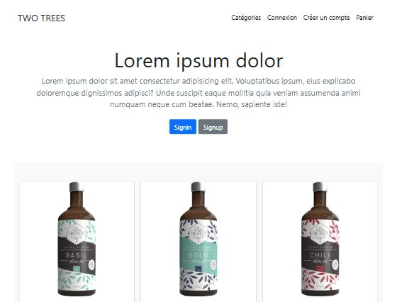
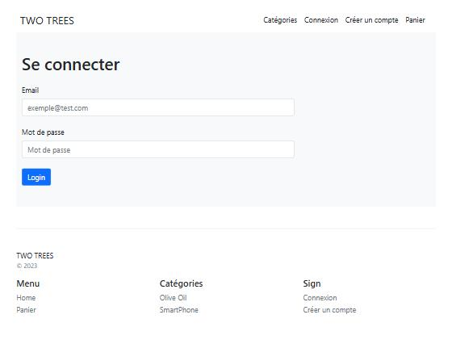
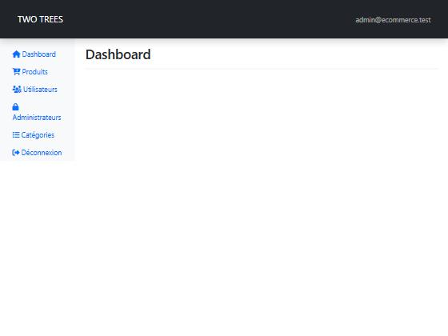
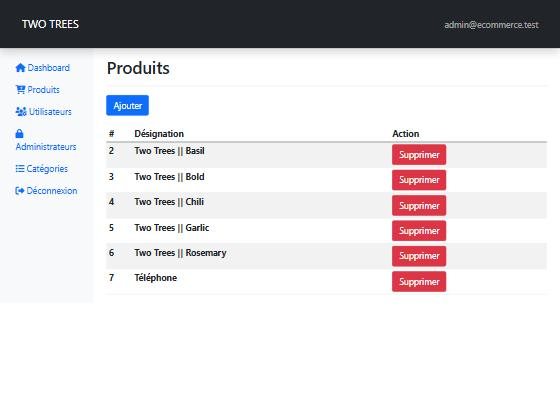
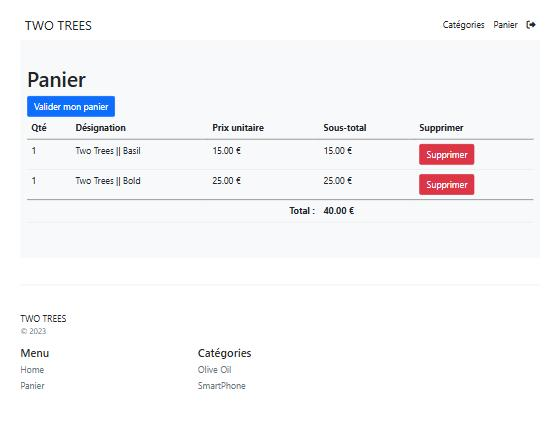
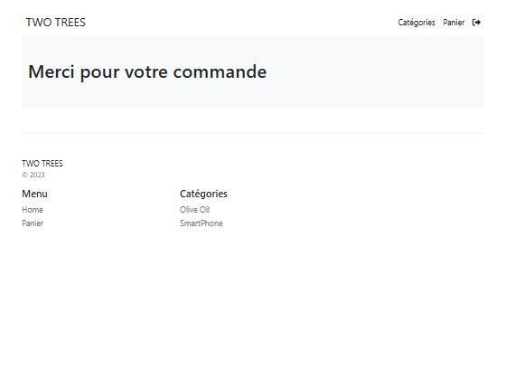
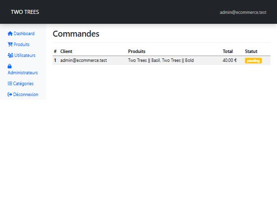

# TWO TREES — Application E-commerce PHP

Application e-commerce en PHP vanilla (sans framework) avec MySQL et Bootstrap 5.

## Captures d'écran

### Page d'accueil


### Connexion


### Dashboard Admin


### Gestion des produits (admin)


### Panier (prix réels)


### Confirmation de commande


### Commandes (admin)


---

## Stack technique

- **PHP 8** - routage via `index.php` + `parse_url()`, sans framework
- **MySQL** via PDO
- **Bootstrap 5** + Font Awesome 6
- **Sessions PHP** pour l'authentification et le panier

## Installation

### Prérequis

- PHP 8.0+
- MySQL / MariaDB
- Serveur web Apache (XAMPP, Laragon…)

### Étapes

1. **Cloner le dépôt dans `htdocs`**

```bash
git clone <repo> htdocs/E-commerce
```

2. **Créer la base de données**

Le schéma SQL n'est pas versionné. Créer la base manuellement :

```sql
CREATE DATABASE ecommerce CHARACTER SET utf8mb4 COLLATE utf8mb4_general_ci;
USE ecommerce;

CREATE TABLE category (
  id   INT NOT NULL AUTO_INCREMENT PRIMARY KEY,
  name VARCHAR(255) NOT NULL
);

CREATE TABLE product (
  id          INT NOT NULL AUTO_INCREMENT PRIMARY KEY,
  name        VARCHAR(255) NOT NULL,
  description TEXT,
  price       DECIMAL(10,2) NOT NULL,
  category    INT NOT NULL,
  filename    VARCHAR(255),
  FOREIGN KEY (category) REFERENCES category(id)
);

CREATE TABLE user (
  id       INT NOT NULL AUTO_INCREMENT PRIMARY KEY,
  email    VARCHAR(255) NOT NULL UNIQUE,
  password VARCHAR(255) NOT NULL,
  admin    TINYINT(1) NOT NULL DEFAULT 0
);

CREATE TABLE user_order (
  id     INT NOT NULL AUTO_INCREMENT PRIMARY KEY,
  statut VARCHAR(50) NOT NULL DEFAULT 'pending',
  user   INT NOT NULL,
  FOREIGN KEY (user) REFERENCES user(id)
);

CREATE TABLE order_product (
  id         INT NOT NULL AUTO_INCREMENT PRIMARY KEY,
  product    INT NOT NULL,
  quantity   INT NOT NULL,
  user_order INT NOT NULL,
  FOREIGN KEY (product)    REFERENCES product(id),
  FOREIGN KEY (user_order) REFERENCES user_order(id)
);
```

Puis créer un compte admin :

```sql
INSERT INTO user (email, password, admin)
VALUES ('admin@example.com', '<hash_bcrypt>', 1);
-- Générer le hash : php -r "echo password_hash('VotreMotDePasse', PASSWORD_BCRYPT);"
```

3. **Configurer les variables d'environnement**

Copier `.env.example` en `.env` et renseigner vos identifiants MySQL :

```bash
cp .env.example .env
```

```env
DB_HOST=localhost
DB_NAME=ecommerce
DB_USER=root
DB_PASSWORD=
```

4. Accéder à `http://localhost/E-commerce/index.php`

---

## Fonctionnalités

### Boutique
- Catalogue produits par catégorie
- Fiche produit détaillée
- Panier (ajout, suppression, total calculé sur le prix réel)
- Validation de commande et page de confirmation

### Authentification
- Inscription / Connexion
- Mots de passe hashés avec **bcrypt** (`password_hash` / `password_verify`)
- Sessions sécurisées

### Back-office (admin)
- Dashboard
- CRUD produits et catégories (import CSV)
- CRUD utilisateurs (import CSV)
- Liste des commandes avec statut

---

## Sécurité

| Problème | Correction |
|---|---|
| Injection SQL | Toutes les requêtes utilisent des requêtes préparées PDO avec paramètres nommés |
| Mots de passe MD5 | Remplacement par `password_hash(PASSWORD_BCRYPT)` |
| Accès admin sans contrôle | Garde `require_admin()` sur chaque route `/admin/*` |
| Total panier hardcodé | Prix stocké en session à l'ajout, utilisé dans le calcul |
| Flux commandes absent | `create_order()` + vue admin orders |

## Structure

```
E-commerce/
├── index.php          # Point d'entrée unique, routeur
├── config.php         # Connexion PDO + chargement .env
├── modele.php         # Accès base de données
├── controllers.php    # Logique métier / vues
├── front/             # Vues publiques
├── admin/             # Vues back-office
├── _partials/         # Header / footer
├── uploads/           # Images produits
├── .env               # Credentials (non versionné)
└── .env.example       # Template credentials
```
